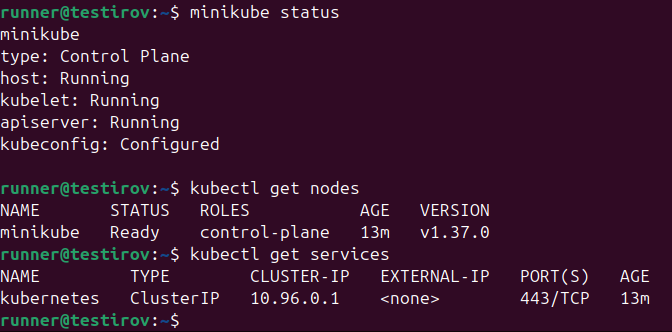
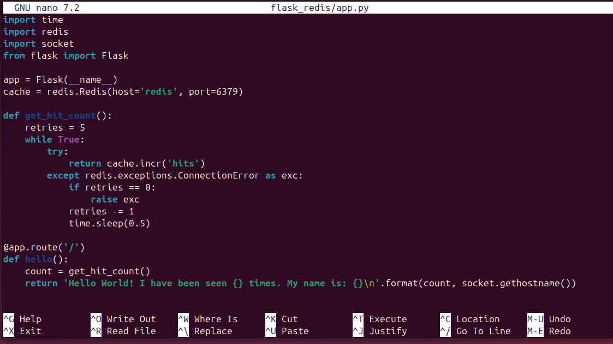
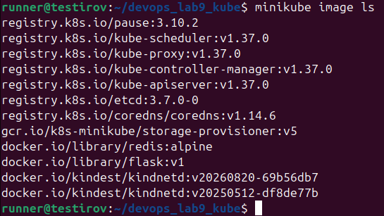
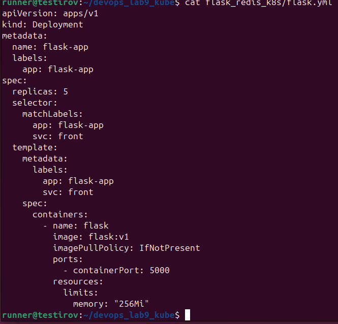
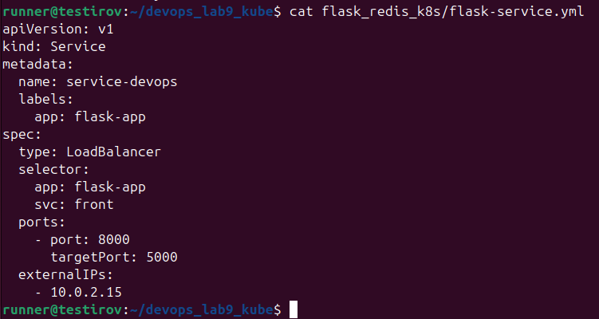
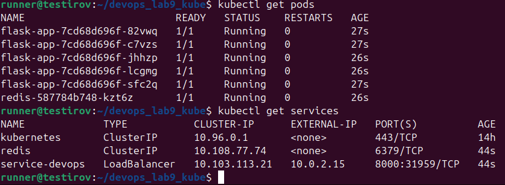
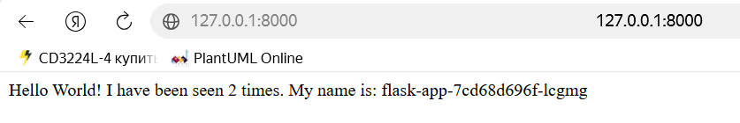
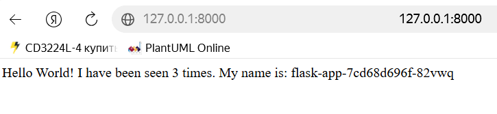
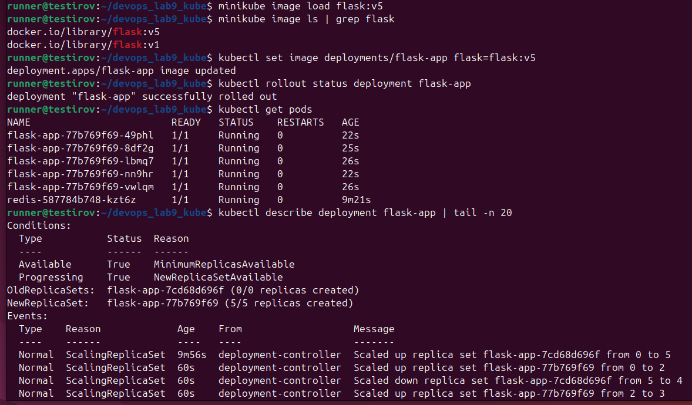
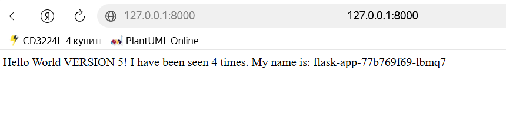

# Практическая работа №9: Основы Kubernetes (Minikube, Deployment, LoadBalancer, Rolling Update)

## Выполнил: [Абубакиров Артур]

### Цель работы
1. Развернуть локальный кластер Kubernetes (`minikube`) на базе драйвера Docker и проверить его работоспособность.
2. Перенести многоконтейнерное приложение (`Flask + Redis`) в среду Kubernetes с использованием декларативных YAML-манифестов (`Deployment`, `Service`).
3. Реализовать балансировку нагрузки между 5 репликами приложения через сервис типа `LoadBalancer` и изолировать базу данных Redis через `ClusterIP`.
4. Продемонстрировать обновление приложения без простоя сервисов по стратегии **Rolling Update**.

---

### Структура проекта
- `flask_redis/` — исходный код веб-приложения на Python/Flask (`app.py`), файл зависимостей `requirements.txt` и `dockerfile`.
- `flask_redis_k8s/` — YAML-манифесты Kubernetes (`flask.yml`, `flask-service.yml`, `redis.yml`, `redis-service.yml`).
- `screenshots/` — скриншоты всех этапов развертывания и тестирования кластера.

---

### Шаг 1. Подготовка ВМ и развертывание кластера Minikube
- Расширено дисковое пространство виртуальной машины (раздел `/dev/sda2` увеличен до 32 ГБ для размещения образов и системных компонентов кластера).
- Установлены клиент управления `kubectl` и инструмент `minikube`.
- Кластер запущен командой `minikube start --vm-driver=docker`, загружен образ сетевого плагина `kindnet`.
- Проверена готовность узла (`Ready`) и всех системных подов в пространстве имен `kube-system`.

---

### Шаг 2. Модификация приложения и загрузка образов в кластер
- Код `flask_redis/app.py` доработан для работы в кластере:
  - Добавлен вывод уникального имени пода (`socket.gethostname()`) для визуализации балансировки нагрузки.
  - Реализован механизм повторных попыток подключения к БД Redis (`retries = 5`) при одновременном старте подов.
- Собран образ `flask:v1` на базе `python:3.10-slim` и загружен внутрь среды Minikube вместе с образом `redis:alpine` (`minikube image load`).
- Наличие образов в локальном хранилище кластера проверено командой `minikube image ls`.

---

### Шаг 3. Развертывание манифестов и балансировка трафика
- В директории `flask_redis_k8s/` созданы 4 манифеста:
  - `flask.yml` (`Deployment`): 5 реплик `flask:v1`, ограничение памяти `256Mi`, `imagePullPolicy: IfNotPresent`.
  - `flask-service.yml` (`Service`, тип `LoadBalancer`): публикация порта `8000` -> `5000` на внешнем адресе `10.0.2.15`.
  - `redis.yml` (`Deployment`): 1 реплика `redis:alpine`.
  - `redis-service.yml` (`Service`, тип `ClusterIP`): внутренний сервис базы данных на порту `6379` (доступен только внутри кластера по DNS-имени `redis`).
- Ресурсы применены командой `kubectl apply -f flask_redis_k8s/`.
- Через `minikube tunnel --bind-address 10.0.2.15` открыт внешний доступ к сервису `LoadBalancer`.
- В браузере хостовой системы (`http://127.0.0.1:8000`) подтверждена балансировка: при каждом обновлении страницы меняются имена отвечающих подов при сохранении единого счетчика просмотров в Redis.

---

### Шаг 4. Обновление приложения без простоя (Rolling Update)
- В код `flask_redis/app.py` добавлена метка новой версии **`VERSION 5!`**.
- Собран новый образ `flask:v5` и загружен в кластер Minikube.
- Выполнено бесшовное обновление подов командой `kubectl set image deployments/flask-app flask=flask:v5`.
- Переключение реплик проконтролировано с помощью `kubectl rollout status deployment flask-app`, `kubectl get pods` и `kubectl describe deployment flask-app` (плавная замена старого `ReplicaSet` на новый без перезапуска пода БД `redis`).
- В браузере подтверждена отдача новой версии **`Hello World VERSION 5!`** с сохранением накопленного счетчика посещений.

